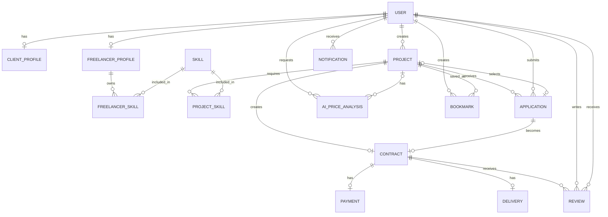

# WorkBridge ERD v1.0

The Prisma schema in `backend/prisma/schema.prisma` is the implementation source of truth.

## Important constraints

- One application per freelancer and project
- One bookmark per user and project
- One review in each direction per contract
- One contract per project and accepted application
- One payment and one final delivery per contract in the MVP
- Project deletion is soft deletion through `deletedAt`
- Recruitment status and transaction status are separate
